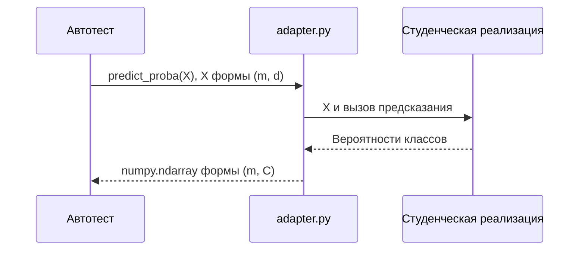

# API v1 для лабораторной работы №1

Контракт задаёт точку входа для автотестов. Студент выбирает классы, модули, способ хранения дерева и организацию вычислений. `adapter.py` может оборачивать существующие функции или классы.

Как автотест получает вероятности классов?



Адаптер согласует интерфейсы; вычисления должны выполняться студенческой реализацией.

## Точка входа

В файле `students/<фамилия-инициалы>/lab1/adapter.py` определите:

```python
API_VERSION = 1

def create_model(
    *,
    categorical_features=(),
    max_depth=None,
    min_samples_split=2,
    min_gain=0.0,
):
    ...
```

`create_model` возвращает новый, ещё не обученный объект с методами ниже. Наследование от заданного класса и совместимость с `sklearn.BaseEstimator` не требуются.

| Параметр | Значение |
|---|---|
| `categorical_features` | Последовательность различных индексов категориальных столбцов, нумерация с нуля; остальные столбцы количественные |
| `max_depth` | Неотрицательное целое или `None`; корень имеет глубину 0, `None` не ограничивает глубину |
| `min_samples_split` | Целое не меньше 2; минимальное число объектов в вершине для поиска разбиения |
| `min_gain` | Конечное неотрицательное число в шкале Джини, заданной в [задании](README.md) |

При одинаковых данных и параметрах результат должен быть воспроизводимым по правилам выбора кандидатов из задания.

## Входные данные

- `X`: двумерный `numpy.ndarray` вещественного типа, форма `(n, d)`, `d >= 1`. Строка соответствует объекту, столбец — признаку.
- Количественные значения конечны; пропуск обозначается `numpy.nan`.
- Категориальные значения — целочисленные коды, представленные в вещественном массиве; пропуск также обозначается `numpy.nan`.
- `y`: одномерный целочисленный `numpy.ndarray` формы `(n,)`. Метки могут быть непоследовательными, например `[-3, 7, 20]`; пропуски запрещены.
- Число и типы столбцов после обучения не меняются. Конечный новый код категории обрабатывается обычным предикатом равенства: если он не равен проверяемой категории, выбирается ветвь 0. В подготовке реального датасета неизвестные категории также можно представлять как `NaN`.

Автотесты передают массивы в указанном формате. Поддержка дополнительных форматов остаётся на усмотрение студента. Методы не должны изменять входные массивы.

## Методы обучаемого объекта

| Метод или атрибут | Контракт |
|---|---|
| `fit(X, y)` | Строит дерево на непустой выборке и возвращает `self`. Повторный вызов полностью заменяет прежнее обучение |
| `classes_` | После `fit` содержит различные обучающие метки по возрастанию; одномерный целочисленный `numpy.ndarray` формы `(C,)` |
| `predict_proba(X)` | Возвращает вещественный `numpy.ndarray` формы `(m, C)`; столбец `j` соответствует `classes_[j]` |
| `predict(X)` | Возвращает целочисленный `numpy.ndarray` формы `(m,)` с метками из `classes_`; выбирает первый максимум вероятности в порядке `classes_` |
| `prune(X_val, y_val)` | Выполняет один проход редукции по заданию, изменяет текущее дерево и возвращает `self`; `classes_` сохраняется |
| `get_tree_stats()` | Возвращает словарь `{"n_nodes": int, "n_leaves": int, "depth": int}` для текущего дерева |

В `get_tree_stats` учитываются только достижимые вершины. Для дерева из одного листа результат равен `{"n_nodes": 1, "n_leaves": 1, "depth": 0}`. Для бинарного дерева выполняется `n_nodes == 2 * n_leaves - 1`.

В `predict_proba` значения конечны, неотрицательны, а сумма строки равна единице с абсолютной погрешностью не более `1e-8`. При сравнении ожидаемых вероятностей автотесты допускают абсолютную погрешность `1e-8`.

| Условие | Действие |
|---|---|
| Дерево ещё не обучено, вызвано предсказание, редукция или получение размеров | Выбросьте `RuntimeError` |
| Пустая обучающая выборка, несовместимые формы, недопустимые параметры или бесконечные значения | Выбросьте `ValueError` |
| В `y_val` есть метки, отсутствующие в `classes_` | Выбросьте `ValueError` |
| На предсказание передано 0 объектов | Верните массив формы `(0, C)` или `(0,)` соответственно |
| На редукцию передана пустая выборка формы `(0, d)` с `y_val` формы `(0,)` | Замените дерево листом с исходным распределением классов в текущем корне |

Если одновременно нарушено несколько условий, порядок их проверки и текст исключения не регламентируются. Неверный формат данных вне описанного контракта не используется для оценки математической реализации.

## Пример использования

Здесь массивы обучающей, валидационной и тестовой выборок уже подготовлены:

```python
from adapter import create_model

model = create_model(categorical_features=(1,), max_depth=4)
model.fit(X_train, y_train)

before = model.predict(X_test)
size_before = model.get_tree_stats()

model.prune(X_val, y_val)

after = model.predict(X_test)
probabilities = model.predict_proba(X_test)
size_after = model.get_tree_stats()
```

Сохранение копии дерева до редукции для эксперимента организуйте самостоятельно. При импорте `adapter.py` допускаются определения и необходимые импорты; загрузка данных, обучение, эксперименты и построение графиков запускаются отдельно. Автотесты загружают адаптер каждой работы в отдельном процессе с каталогом `lab1` в пути поиска модулей.

## Окружение автопроверки

Адаптер выполняется в Linux-контейнере с Python 3.13. Укажите зависимости в `lab1/requirements.txt`. Автопроверка автоматически устанавливает их через `pip` в отдельное окружение для вашей работы. Предварительное согласование пакетов Python не требуется. Для воспроизводимости фиксируйте версии в списке зависимостей.

В PR обязательны непустые `README.md` и `adapter.py`, а также `requirements.txt`. Если дополнительных зависимостей нет, файл `requirements.txt` может быть пустым. Поддерживается стандартный формат `pip`, включая вложенные списки `-r` и локальные пакеты внутри каталога лабораторной. NumPy устанавливается для транспорта массивов. Если нужна конкретная версия NumPy, укажите её в `requirements.txt`.

Установка выполняется в отдельном контейнере с сетью и доступом к файлам лабораторной. На подготовку окружения отводится до 10 минут и 2 ГиБ памяти. При ошибке установки, превышении времени или памяти в PR появляется соответствующее сообщение; численные тесты не запускаются. Подробный ограниченный журнал доступен преподавателю в закрытом артефакте. Сбой Docker или подготовки образа сообщается отдельно как сбой инфраструктуры.

Во время численных тестов контейнер работает без сети. Каталог лабораторной доступен для чтения, временные файлы можно создавать в `/tmp`. Лимиты составляют 512 МиБ памяти, 1 CPU, 64 процесса и 64 МиБ временных файлов. Один вызов адаптера ограничен 5 секундами, один случай проверки — 60 секундами. Эти лимиты ограничивают зависшие вызовы и расход ресурсов runner. Проверки используют небольшие преподавательские выборки, а не полный датасет эксперимента.
